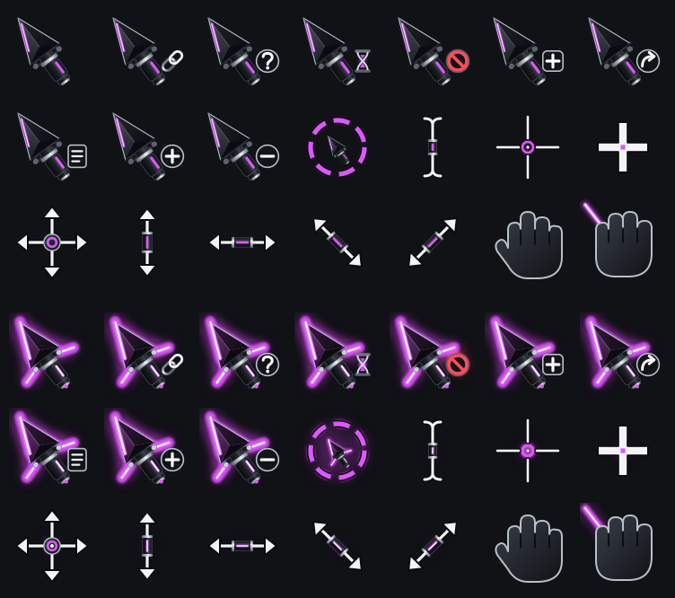

# Kyber Cursor

A mouse pointer for Omarchy / Hyprland inspired by the lightsaber from Star Wars, the iconic weapon of a very famous space opera. Kyber is the crystal that gives a saber its color, and here your theme's accent plays that part. The pointer is a dark faceted spearhead with a short hilt, lit along its edge in your theme's accent. **Hold a mouse button** and it ignites: a brighter blade, two crossguard beams, a glow that pulses, and a fading light trail when you drag. Optional sound effects.



## Features
- Full cursor set (pointer, link, busy, text, crosshair, move, resize, grab, not-allowed...), regenerated in the current accent on every `omarchy theme set` and at boot.
- Click-and-hold glow with ignition animation, beams growing out of the emitters, a slow pulse, and a drag trail (toggle it off with `kyber trail off` if you find it distracting).
- The glow adapts to the page behind it: a pale, defined version over white pages, a vivid one over dark ones.
- Optional sounds (bring your own clips): ignite after a 0.3 s hold, off on release, a clash on double-click. A hotkey cycles all / ignite-only / mute.
- Dark accents (deep orange, red, purple) are brightened so every theme glows about equally.

## Requirements
Hyprland (0.56 tested) on Omarchy, plus (Arch):

```
sudo pacman -S --needed python-gobject python-cairo python-pillow python-cairosvg python-evdev gtk4 gtk4-layer-shell grim pipewire
```

and membership in the `input` group (the click glow reads mouse-button events from `/dev/input`; see Safety):

```
sudo usermod -aG input "$USER"    # then reboot
```

## Install
```
omarchy plugin add https://github.com/s3pp3ku/kyber-cursor --enable
~/.config/omarchy/plugins/io.github.s3pp3ku.kyber-cursor/install.sh
```
(or `git clone` it anywhere and run `./install.sh`). The installer lists every step and asks first. It:
1. links `kyber` into `~/.local/bin`
2. adds a systemd **user** service `kyber-ignite` (the click glow)
3. adds theme-set and post-boot hooks under `~/.config/omarchy/hooks/`
4. creates empty sound folders under `~/.config/kyber-cursor/sounds/`
5. builds and applies the cursor

Remove everything with `./uninstall.sh`, which restores the Adwaita cursor. No sudo, no network at install or run time.

## Use
```
kyber apply        # rebuild in the current accent and switch to it
kyber off          # back to Adwaita (the glow stops too)
kyber sound        # cycle sound mode: all -> ignite -> mute
kyber trail        # toggle the drag trail (or: trail on / trail off)
kyber status
```
Bind the sound and trail toggles to keys if you like. In Omarchy's Lua bindings (`~/.config/hypr/bindings.lua`):
```lua
o.bind("F10", "Cycle saber sound", "kyber sound")
o.bind("F11", "Toggle drag trail", "kyber trail")
```

## Sounds
No clips are bundled. Put `.wav` / `.mp3` / `.ogg` files in:

| Folder | Plays when |
|---|---|
| `~/.config/kyber-cursor/sounds/ignite/` | a button is held longer than 0.3 s (random clip) |
| `~/.config/kyber-cursor/sounds/off/` | the button is released after an ignite sound |
| `~/.config/kyber-cursor/sounds/clash/` | double-click. A clip named `2-...` is played once, any other clip is played twice |

Empty folders mean silence. Clips play through `pw-play` at 55% volume (`SOUND_VOLUME` in `lib/ignite-listener`). Use clips you have the right to use.

## How it works, and its limits
On Hyprland 0.56 `hyprctl setcursor` only changes what *future* cursor requests resolve to; the image on screen stays until an app re-requests its cursor, which never happens mid-click. So the ignition is not a cursor swap. A small GTK4 layer-shell overlay (click-through, empty input region) draws the glow *under* the real cursor and follows it. The real pointer is never touched, so pointer latency is unchanged.

- The overlay doesn't know the current cursor shape, so the glow also appears around an I-beam during a text drag.
- Right after a theme switch the rebuild takes 1-2 s, so the old color shows briefly.
- The glow only follows the cursor's logical position. On very unusual scaling setups the overlay can be slightly off; set `CURSOR_OVERLAY_SCALE` (e.g. `1.05`) in the service environment to fine-tune.
- Tested on one machine (Hyprland 0.56, 1.6x scaling). Reports from other setups are welcome.

## Safety
- The listener opens `/dev/input/event*` **read-only and without grabbing** them (no `EVIOCGRAB`), so clicks still reach Hyprland and apps unchanged. It counts button presses only: no keys, no coordinates from the device, no network.
- The overlay can never take a click (empty input region).
- It reads a 20x20 pixel patch of your screen next to the cursor, via `grim`, on each press to pick the dark or light glow. It is averaged to one brightness number in memory and never saved or sent anywhere.
- The service runs with `NoNewPrivileges`, `ProtectSystem=strict`, `ProtectHome=read-only`.
- The `input` group lets any program you run read raw input events from all your input devices (including keyboards). Only add yourself if you accept that.

## Customizing
Constants at the top of `lib/ignite-listener` (pulse, trail, timings, volume) and `lib/build.py` (shape, glow strength) are plain numbers. `IGNITE_COLOR` in `build.py` pins the glow to a fixed color instead of the accent.

## License
MIT.

*Kyber Cursor is an independent fan project and isn't affiliated with or endorsed by Lucasfilm or Disney. It bundles no film audio or artwork.*
