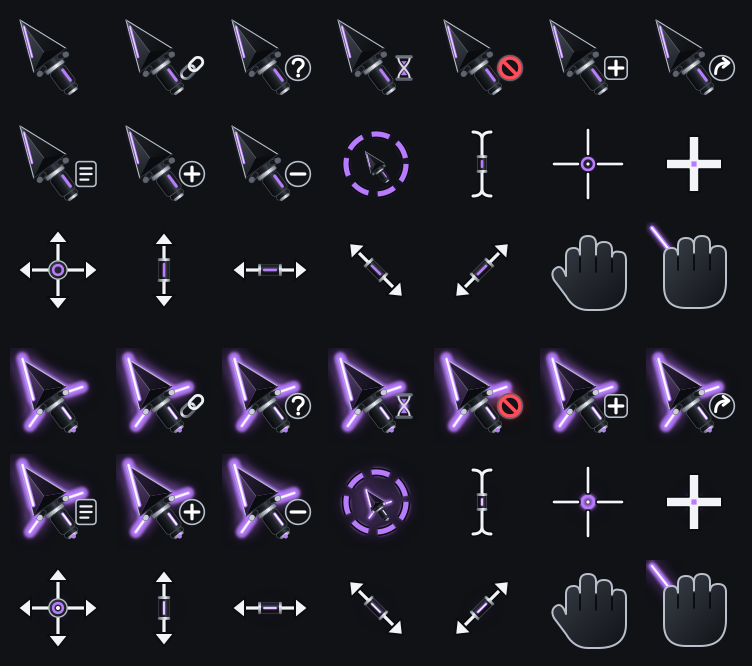

# Kyber Cursor

A mouse pointer for Omarchy / Hyprland, inspired by the iconic laser sword of a very famous space opera. Kyber is the crystal that gives that blade its color, and here your theme's accent plays that part. The pointer is a dark faceted spearhead with a short hilt, lit along its edge in your theme's accent. **Hold a mouse button** and it ignites with a brighter blade, two crossguard beams and a pulsing glow, plus a fading light trail when you drag. Sound effects are optional.


[Watch the clip (mp4, no sound)](media/demo.mp4)

| Ignited | Dragging |
|---|---|
|  |  |

The options popup: pick where the glow color comes from (Theme, Custom or Random), the sound mode and volume, and the drag trail.


Every cursor role, generated from the accent:



## Features
- Full cursor set (pointer, link, busy, text, crosshair, move, resize, grab, not-allowed...), regenerated in the current accent on every `omarchy theme set` and at boot.
- Click-and-hold glow with ignition animation, beams growing out of the emitters, a slow pulse, and a drag trail (toggle it off with `kyber trail off` if you find it distracting).
- The glow adapts to the page behind it: a pale, defined version over white pages, a vivid one over dark ones.
- A bar button with a popup: a color picker (hue, vividness and brightness bars plus presets), sound mode and volume, drag trail and on/off switches. No terminal needed.
- Three glow-color sources: **Theme** (follows the Omarchy accent, the default), **Custom** (your own color) and **Random** (a new vivid color at each theme change and at boot, or on demand). Random colors are always bright and clearly different from the last one.
- Sounds: ignite after a 0.3 s hold, off on release, a clash on double-click. A small original pack is generated for you (no recordings bundled), and you can add your own. A hotkey cycles all / ignite-only / mute.
- Dark accents (deep orange, red, purple) are brightened so every theme glows about equally.

## Easiest way: let an AI assistant set it up
New to Linux? You don't have to type any commands yourself. If you use an AI coding assistant (Claude Code, Codex, Gemini CLI and similar), paste this to it:

> Set up Kyber Cursor on my Omarchy computer. Read https://raw.githubusercontent.com/s3pp3ku/kyber-cursor/main/AGENTS.md first and follow it exactly. Explain things to me in plain English, and ask me before anything that needs my password, restarts the computer or the desktop shell, or changes my top bar.

What happens next, in plain words:
1. The assistant asks, then downloads Kyber from GitHub and adds it to Omarchy's plugin list (the normal way to install a plugin). No password.
2. It shows you a short **preview** of what it is about to do, and waits for your OK.
3. It sets everything up. This part needs no password. Kyber makes its own simple sound effects on your computer, and nothing is downloaded.
4. It then goes through a short checklist **with you**, asking before each item:
   - one command that installs a few helper programs (needs your password, so *you* run it);
   - an **optional** permission for the click glow (explained below);
   - one restart of the desktop shell, only if you chose the optional Kyber button on your top bar.
5. It checks that everything works and tells you how to try it: hold the left mouse button for a second.

The assistant is told never to run `sudo` for you, never to download sounds, and to stop and ask if anything looks odd. You can say no to anything and still keep the cursor.

**The one permission worth understanding:** the click glow needs to know when you press a mouse button, anywhere on screen. Linux only tells that to programs you have put in a group called `input`. The catch is that the permission belongs to *you*, so any program you run could then also read your keyboard and mouse input. If you are not comfortable with that, skip it: you still get the cursor in your theme's color, and only the glow, trail and sounds stay off. (More in "Is this safe?" below.)

Prefer to do it yourself? Use the Install section below, or run `kyber setup` from the plugin folder. It shows a preview first and changes nothing until you add `--yes`.

## Is this safe? (plain English)

**What is it?** Two parts. (1) A cursor theme: just picture files, like any other cursor pack. (2) A small helper program that draws the glow when you hold a mouse button.

**Why does the glow need the "input group"?** On Linux, mouse and keyboard signals arrive in a locked room (`/dev/input`). Only people on a short list, the `input` group, may listen at that door. The helper has to know "is a mouse button held *anywhere on screen*?", and no normal app is told that, so it has to listen at the door. Adding yourself to the list is that permission.

**What's the honest catch?** The list applies to *you*, so any program you run could also listen at that door, **including your keyboard**. That is how Linux works, not something this plugin does, but it is a real trade-off, so don't add yourself unless you are comfortable with it.

**What does the helper actually do?** It checks one thing: is the left, right or middle button down? It ignores keys and mouse movement. It has no network code at all, it saves nothing, and it is about 500 lines of readable Python (`lib/ignite-listener`). It does not block or change your clicks; it only watches.

**Can I skip the group?** Yes. Without it you still get the cursor in your theme's accent. The click glow, trail and sounds simply stay off. The installer detects this and doesn't start the helper.

**Could a command here be hiding something?** The installer never runs `sudo` and never downloads anything. The one `sudo` command is only *printed* for you to read and run yourself. It asks before every change, and `./uninstall.sh` reverses all of it. Don't take my word for it. This searches the code for anything that downloads, talks to the internet or runs hidden code, and it should print nothing:

```
grep -nE "curl|wget|urllib|AF_INET|import requests|\beval\b|base64" bin/* lib/* install.sh uninstall.sh Service.qml
```

(The only socket the helper opens is the local one Hyprland provides, to ask where the cursor is.)

## Requirements
Hyprland (0.56 tested) on Omarchy, plus these packages (Arch names):

```
sudo pacman -S --needed python-gobject python-cairo python-pillow python-cairosvg python-evdev gtk4 gtk4-layer-shell grim pipewire
```

You also need to be in the `input` group, because the click glow reads mouse-button events from `/dev/input` (see Safety):

```
sudo usermod -aG input "$USER"    # then reboot
```

## Install
```
omarchy plugin add https://github.com/s3pp3ku/kyber-cursor --enable
~/.config/omarchy/plugins/io.github.s3pp3ku.kyber-cursor/install.sh
```
(or `git clone` it anywhere and run `./install.sh`). The installer lists every step and asks first. It:
1. links `kyber` into `~/.local/bin`
2. adds a systemd **user** service `kyber-ignite` (the click glow)
3. adds theme-set and post-boot hooks under `~/.config/omarchy/hooks/`
4. creates the sound folders under `~/.config/kyber-cursor/sounds/` and fills empty ones with the generated original pack
5. builds and applies the cursor

(The AI-assistant route skips `--enable` on purpose: the cursor and glow do not need it, and the optional bar-button step turns the plugin on.)

Shortcut: after the first command, `~/.config/omarchy/plugins/io.github.s3pp3ku.kyber-cursor/bin/kyber setup` previews the setup and `... setup --yes` does the non-privileged part (add `--bar` for the bar button).

Remove everything with `./uninstall.sh`, which restores the Adwaita cursor. The installer itself uses no sudo and no network, and the plugin needs neither at run time.

## Updating
```
omarchy plugin update io.github.s3pp3ku.kyber-cursor
omarchy-restart-shell      # once, so the shell loads the new bar button and popup
kyber doctor               # checks everything and says how to fix anything missing
```
The Plugin Manager shows a green arrow next to Kyber when an update is available, and its Update button does the same as the first command. An update does not re-run `install.sh`, place the bar button or generate sounds for you. After updating from 1.0 or 1.1:
- add the button with `omarchy bar put io.github.s3pp3ku.kyber-cursor` (optional);
- run `kyber sounds default` to fill empty sound folders with the original pack (optional; it never replaces clips you added);
- sound volume now uses a curved scale. If you set one in 1.1, raise it (about 55 gives what 18 used to).

See [CHANGELOG.md](CHANGELOG.md) for what changed in each version.

## Use
```
kyber apply        # rebuild in the current accent and switch to it
kyber off          # back to Adwaita (the glow stops too)
kyber sound        # cycle sound mode: all -> ignite -> mute
kyber trail        # toggle the drag trail (or `kyber trail on` / `kyber trail off`)
kyber color theme|custom|random   # where the glow color comes from
kyber color #ff7a00   # a color of your own (switches to custom)
kyber random       # roll a new random color now (switches to random)
kyber volume 40    # sound volume, 0-100
kyber config       # every setting as one line of JSON
kyber status
```
### The bar button
Add it to your bar with `omarchy bar put io.github.s3pp3ku.kyber-cursor` (the installer doesn't touch your bar). Left-click opens the options popup, middle-click cycles the sound, right-click turns Kyber on or off.

Bind the sound and trail toggles to keys if you like. In Omarchy's Lua bindings (`~/.config/hypr/bindings.lua`):
```lua
o.bind("F10", "Cycle Kyber sound", "kyber sound")
o.bind("F11", "Toggle drag trail", "kyber trail")
```

## Sounds
Kyber bundles **no recordings**. The installer generates a small original sound pack on your machine, so sound works right away. The pack is synthesized from sine waves and filtered noise by `lib/make_sounds.py` (MIT, like the rest of the project): 3 ignites, 2 offs and 5 clashes. Nothing is downloaded or sampled from anywhere.

```
kyber sounds default        # (re)generate the pack into empty folders
kyber sounds preview        # play one of each, at your volume setting
kyber sounds list           # what you have
kyber sounds add FILE ignite|off|clash    # add a clip of your own
```

Want different sounds? Add your own `.wav` / `.mp3` / `.ogg` / `.flac` files with `kyber sounds add`, or drop them into the folders below. Good sources are your own recordings and CC0 or royalty-free libraries (for example Freesound with the CC0 filter, Pixabay or Mixkit), but check each file's license. Film, TV and game audio is copyrighted, so those clips can't be bundled or shared here, and pull requests that add them will be declined.

| Folder | Plays when |
|---|---|
| `~/.config/kyber-cursor/sounds/ignite/` | a button is held longer than 0.3 s (random clip) |
| `~/.config/kyber-cursor/sounds/off/` | the button is released after an ignite sound |
| `~/.config/kyber-cursor/sounds/clash/` | you double-click (a clip named `2-...` plays once; any other clip plays twice) |

Empty folders mean silence. Clips play through `pw-play`. The volume (`kyber volume 0-100`, default 55, or the slider in the popup) uses the same curved scale as system volume sliders, so the percentage matches how loud it sounds.

## Troubleshooting
Run `kyber doctor`. It checks the dependencies, the `input` group, the glow service, the hooks and the sounds, and prints the fix for anything missing. It only reads; it never changes your system. If you use an AI coding agent to set this up, point it at `AGENTS.md`.

## How it works, and its limits
On Hyprland 0.56, `hyprctl setcursor` only changes what *future* cursor requests resolve to; the image on screen stays until an app re-requests its cursor, which never happens mid-click. So the ignition is not a cursor swap. A small GTK4 layer-shell overlay (click-through, empty input region) draws the glow *under* the real cursor and follows it. The real pointer is never touched, so pointer latency is unchanged.

- The glow and trail are made for dark and mid-tone backgrounds. On very light pages they are subtler (a defined but faint halo), so they don't look like the demo there.
- The overlay doesn't know the current cursor shape, so the glow also appears around an I-beam during a text drag.
- Right after a theme or color change, the rebuild takes 1-2 s. The glow updates at once, but the real pointer image refreshes the next time you move onto another window or the bar. That is how Hyprland handles cursor themes, and it affects every cursor theme, not just Kyber.
- The glow only follows the cursor's logical position. On unusual scaling setups the overlay can be slightly off; set `CURSOR_OVERLAY_SCALE` (e.g. `1.05`) in the service environment to fine-tune.
- Tested on one machine (Hyprland 0.56, 1.6x scaling). Reports from other setups are welcome.

## Safety
- The listener opens `/dev/input/event*` **read-only and without grabbing** them (no `EVIOCGRAB`), so clicks still reach Hyprland and apps unchanged. It counts button presses only: no keys, no coordinates from the device, no network.
- The overlay can never take a click (empty input region).
- It reads a 20x20 pixel patch of your screen next to the cursor, via `grim`, on each press to choose the dark or light glow. The patch is averaged to a single brightness number in memory and is never saved or sent anywhere.
- The service runs with `NoNewPrivileges`, `ProtectSystem=strict`, `ProtectHome=read-only`.
- The `input` group lets any program you run read raw input events from all your input devices (including keyboards). Only add yourself if you accept that.

## Customizing
Constants at the top of `lib/ignite-listener` (pulse, trail, timings, volume) and `lib/build.py` (shape, glow strength) are plain numbers. `IGNITE_COLOR` in `build.py` pins the glow to a fixed color instead of the accent.

## License
MIT.

*Kyber Cursor is an independent, fan-made project created with the help of AI tools. It is not affiliated with or endorsed by the Mouse, and it bundles no film audio or artwork.*
